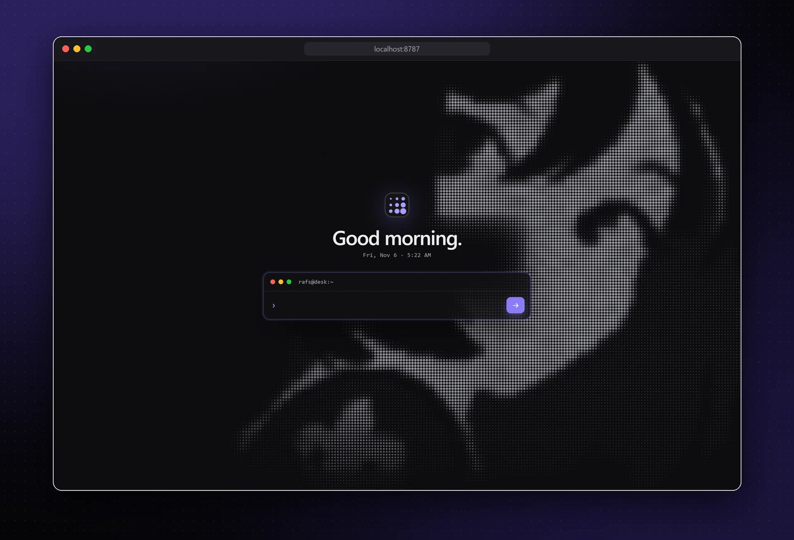
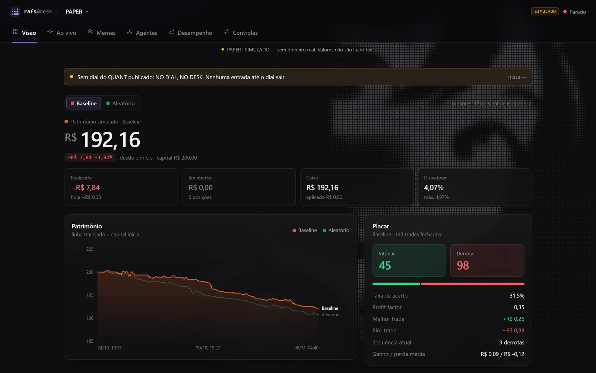
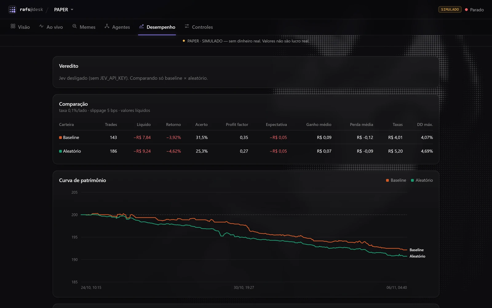
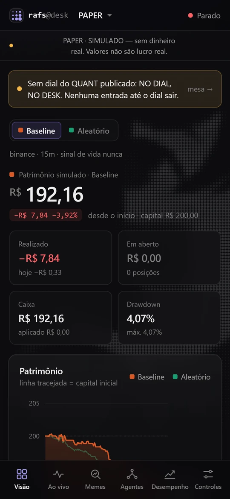
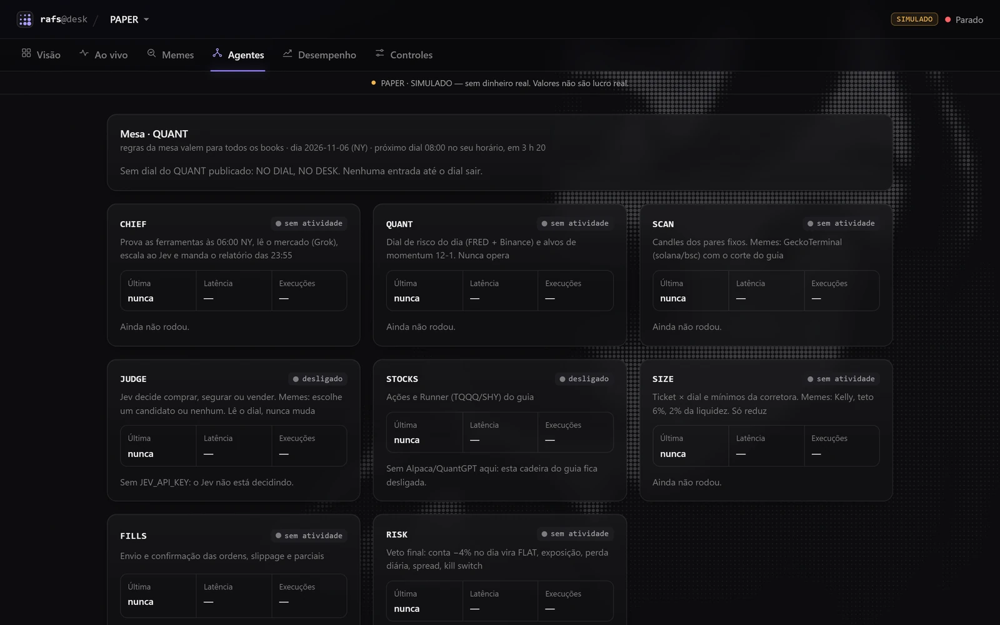

<div align="center">



# rafs

**Uma IA decide melhor que uma regra simples ou que uma moeda jogada pro alto?**
Um bot de paper trading feito para responder isso com números, não com print de lucro.

[](https://github.com/dhfullstack/rafs/actions/workflows/tests.yml)


</div>

---

## O experimento

Três carteiras simuladas de R$ 200 rodam lado a lado, sobre os mesmos candles, com as mesmas taxas, o mesmo
slippage e as mesmas regras de risco. A única diferença é quem decide:

| Carteira | Quem decide |
|---|---|
| `jev` | A API do [Jev](https://iajev.com), que julga entrada (alvo antes do stop?) e saída (SELL/HOLD) |
| `baseline` | Regra fixa: EMA12 > EMA26, RSI 45–70, momentum > 0, preço acima da VWAP |
| `random` | Entradas aleatórias reproduzíveis: o grupo de controle |

Se o Jev não superar as outras duas em líquido **e** em profit factor depois de 100 trades, a hipótese morre. O
critério de parada foi escrito antes de ver qualquer resultado.

## O painel







<details>
<summary>Agentes da mesa</summary>
<br>

</details>

Servidor HTTP próprio, sem framework: login com senha e sessão, CSRF, limite de tentativas, CSP estrita. Vira app
na tela de início do iPhone. Serve para **acompanhar e frear** (pausar, kill switch), nunca para mudar limites ou
ver chaves. Os gráficos (patrimônio, drawdown, P&L diário, distribuição dos retornos) são SVG desenhado à mão, e o
fundo em halftone é um `<canvas>` gerado a partir de um mapa de tons de 243×196 px.

> **Os prints usam dados fictícios**, gerados por [`scripts/seed_demo.py`](scripts/seed_demo.py) só para mostrar a
> interface (98 vitórias, 24 derrotas, US$ 88.234,22). Não saíram de nenhuma execução real. Os números de verdade
> estão em [O que os números disseram](#o-que-os-números-disseram-até-agora), e por enquanto são bem menos bonitos.

## Modos

| Modo | Dados | Execução |
|---|---|---|
| `PAPER` (padrão) | Binance real (público) | Simulada localmente, com taxa e slippage |
| `TESTNET` | Binance Spot Testnet | Ordens reais na testnet, dinheiro fictício |
| `FUTURES` | Binance Futures demo (USDT-M) | Long e short a 1x na conta demo |
| `BACKTEST` | Histórico da Binance | Decide no fechamento de t, executa na abertura de t+1 |

**Não existe modo LIVE.** `MODE=LIVE` é recusado na inicialização.

## Rodando

```bash
python -m venv .venv
.venv\Scripts\python -m pip install -r requirements.txt
copy .env.example .env
```

```bash
.venv\Scripts\python -m rafs check                      # testa Binance, Jev e notificações
.venv\Scripts\python -m rafs backtest --days 30         # backtest sem gastar crédito
.venv\Scripts\python -m rafs run --dashboard            # paper ao vivo + painel em localhost:8787
.venv\Scripts\python -m rafs report                     # saldo, posições e comparação
.venv\Scripts\python -m pytest -q                       # 191 testes
.venv\Scripts\python scripts\seed_demo.py showcase       # banco fictício para ver o painel
```

Sem `JEV_API_KEY` o bot roda só com `baseline` e `random`. Sem `DASHBOARD_PASSWORD`, a senha do painel é gerada
na primeira execução e impressa no terminal.

## Arquitetura

```
SCAN (candles + indicadores) → filtro de tendência → JUDGE (Jev) → SIZE → RISK → FILLS
```

| Peça | Onde | O que faz |
|---|---|---|
| Deciders | `rafs/deciders/` | `jev`, `baseline` e `random` atrás da mesma interface |
| Corretoras | `rafs/exchanges/` | Contratos `MarketDataProvider` / `ExchangeProvider`; paper, testnet e futuros demo |
| Motor | `rafs/engine.py` | O mesmo `process_candle` no backtest e no ao vivo |
| Tamanho | `rafs/sizing.py` | Ticket × dial de risco do dia (o dial só reduz) |
| Risco | `rafs/risk.py` | Veto final: perda diária, exposição, spread, pausa, kill switch |
| Painel | `rafs/dashboard/` | HTTP + HTML/CSS/JS puros, só leitura do banco |

Decisões que importam:

- **Saídas iguais para todos:** stop em 2×ATR, alvo em 3×ATR, saída por tempo após 32 candles. Stop e alvo no
  mesmo candle contam como stop.
- **Sem look-ahead:** o backtest usa o mesmo código do ao vivo.
- **Recuperação após queda:** estado em SQLite; candles já decididos não são decididos de novo, e a chave de
  idempotência do Jev vem do candle, então um restart não cobra duas vezes.
- **Prompt injection:** os modelos só recebem números calculados localmente e símbolos validados por regex.
  Nenhum texto externo entra no estado.

## O que os números disseram até agora

Backtest de 30 dias em 15m, taxa 0,10% por lado, slippage 5 bps (simulado):

| decider | trades | líquido R$ | win % | profit factor |
|---|---|---|---|---|
| baseline | 267 | −9,82 | 34,5 | 0,42 |
| random | 395 | −13,64 | 28,1 | 0,33 |

As taxas são cerca de 75% do prejuízo: em 15 min o movimento típico (ATR ≈ 0,2%) é do tamanho do custo de ida e
volta (≈ 0,3%). Para valer a pena, o Jev precisa acertar bem mais que isso.

## Mais

O manual completo (testnet, futuros, Telegram, Discord, o dial de risco, a mesa de agentes, limitações conhecidas)
está em [docs/GUIA.md](docs/GUIA.md).

---

<sub>Projeto de estudo. Nada aqui é recomendação de investimento, e nenhum resultado mostrado é lucro real.</sub>
